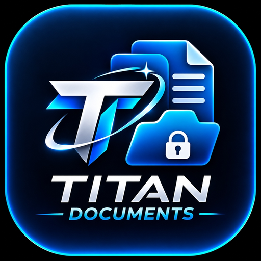

# 📁 Titan Documents

<p align="center">
  
</p>

<p align="center">
  <strong>The Ultimate Offline-First Personal Document Vault for Android, Windows & Web</strong><br>
  <em>Part of the Titan Plus Ecosystem • Engineered with ❤️ by Pushpendra</em>
</p>

<p align="center">
  
  
  
  
  
  
</p>

---

## 📑 Table of Contents

- [📱 Download Production Android APK](#-download-production-android-apk)
- [💡 Overview & Architecture](#-overview--architecture)
- [✨ Core Features & Capabilities](#-core-features--capabilities)
  - [1. 🔒 Built-in 4-Digit App Lock (PIN Security)](#1--built-in-4-digit-app-lock-pin-security)
  - [2. 📦 Full Vault Backup to ZIP](#2--full-vault-backup-to-zip)
  - [3. 📲 Universal ZIP Export & System Share](#3--universal-zip-export--system-share)
  - [4. 🛡️ Comprehensive In-App Privacy Policy](#4-️-comprehensive-in-app-privacy-policy)
  - [5. ⚡ Zero Black Screen Startup (Instant Launch)](#5-️-zero-black-screen-startup-instant-launch)
  - [6. 🔍 Pinch-to-Zoom & Pan Gesture Engine](#6--pinch-to-zoom--pan-gesture-engine)
  - [7. 📄 100% Offline Mozilla PDF.js Engine](#7--100-offline-mozilla-pdfjs-engine)
  - [8. ✏️ In-App Document Renaming](#8-️-in-app-document-renaming)
  - [9. 📲 Android System File Provider Integration](#9--android-system-file-provider-integration)
  - [10. 🗂️ Universal Format Support & Real-Time Thumbnails](#10-️-universal-format-support--real-time-thumbnails)
- [🎨 Titan SaaS Design System Architecture](#-titan-saas-design-system-architecture)
- [🧭 3-Dots (⋮) Settings & Management Menu](#-3-dots--settings--management-menu)
- [📂 Project Directory Structure](#-project-directory-structure)
- [🚀 Local Execution & Build Instructions](#-local-execution--build-instructions)
  - [1. Web Browser Mode](#1-web-browser-mode)
  - [2. Standalone Windows Desktop App](#2-standalone-windows-desktop-app)
  - [3. Rebuilding Android APK with Gradle](#3-rebuilding-android-apk-with-gradle)
- [🔐 Privacy Guarantee & Policy](#-privacy-guarantee--policy)
- [👨‍💻 Author & Credits](#-author--credits)

---

## 📱 Download Production Android APK

Download the compiled, production-ready Android APK directly from the repository:

👉 **[Download TitanDocuments.apk (Latest Build)](./TitanDocuments.apk)**

> **Security Assurance**: Titan Documents is 100% offline and standalone. No network permissions are required for core document management, guaranteeing zero telemetry and complete safety.

---

## 💡 Overview & Architecture

**Titan Documents** is a private, offline-first personal document vault engineered under the **Titan Plus Ecosystem**.

Standard cloud-based document viewers and storage services continuously sync private data to remote servers, require active internet connections, and inject ads or user analytics. **Titan Documents** redefines personal document management:
- **100% Local Sandboxing**: Every file is stored locally as lossless binary blobs in IndexedDB.
- **Privacy by Design**: Zero telemetry, zero analytics tracking, and zero external script injection.
- **Zero Blank-Screen PDF Rendering**: Built-in Mozilla PDF.js eliminates the blank white-screen flaw typical of Android WebViews.
- **Deep Android OS Integration**: Features hardware pinch-to-zoom, system file provider (uploading files inside WhatsApp, Chrome, or job portals), an anti-bypass 4-digit App Lock, and one-tap archive backups.

---

## ✨ Core Features & Capabilities

### 1. 🔒 Built-in 4-Digit App Lock (PIN Security)
- **Settings Access**: Accessible directly via the header 3-dots (⋮) menu to toggle App Lock on or off.
- **Secure PIN Setup**: Intuitive modal flow to enter, verify, and confirm a 4-digit security PIN.
- **Full-Screen Authentication Gate**: Upon app launch or return, a sleek tactile lock screen blocks all vault contents until the correct PIN is provided.
- **Anti-Bypass Protection**: Hardware back-button events and navigation gestures are intercepted so the lock gate cannot be skirted.
- **Protected Deactivation**: Disabling the lock requires re-authenticating with the active PIN.

---

### 2. 📦 Full Vault Backup to ZIP
- **Unified Archiving**: Tap **"Backup all files into zip"** in the 3-dots menu to instantly bundle every stored file (PDFs, images, spreadsheets, text files, archives, code) into a single `.zip` file.
- **Lossless Deflate Engine**: Utilizes bundled offline `JSZip` for rapid, zero-quality-loss compression.
- **Intelligent Collision Resolution**: Files sharing duplicate names receive automated numeric suffixes (e.g., `invoice (1).pdf`) to ensure zero overwriting or data loss.
- **Instant Local Storage**: Saves directly to the device's native `Downloads/TitanDocuments` directory with automated timestamping (e.g., `Titan_Backup_2026-11-21_2105.zip`).

---

### 3. 📲 Universal ZIP Export & System Share
- **One-Tap Workflow**: Select **"Share all files as zip"** in the 3-dots menu.
- **Safety Confirmation**: An elegant confirmation dialog verifies your action before archiving begins.
- **Automatic Packaging**: The app generates a unified lossless `.zip` backup package in memory.
- **Native Android Share Sheet**: Directly invokes the system chooser (`Intent.createChooser`) with all installed sharing channels (Google Drive, WhatsApp, Gmail, Telegram, Quick Share, Files, etc.).
- **Total Versatility**: Send the ZIP to any device, cloud destination, or messaging contact with a single tap.

---

### 4. 🛡️ Comprehensive In-App Privacy Policy
- Dedicated **"Privacy Policy"** modal accessible from the header 3-dots menu.
- Clearly states the foundational privacy commitments:
  - Sandboxed on-device storage.
  - Zero data telemetry, tracking cookies, or advertising identifiers.
  - Hashed, non-synced App Lock PIN credentials.
  - Complete data sovereignty (export, transfer, or delete at will).
  - Session-scoped, ephemeral File Provider access.

---

### 5. ⚡ Zero Black Screen Startup (Instant Launch)
- Eliminates the 1–2 second black screen common during Android WebView cold starts.
- Synchronizes the Android native window background, splash theme, and WebView background to the signature `#F8F9FD` canvas for a flicker-free, instant startup.

---

### 6. 🔍 Pinch-to-Zoom & Pan Gesture Engine
- **Two-Finger Pinch**: Fluid pinch gestures support scaling up to 500% (5x) for both high-resolution photos and PDF pages.
- **One-Finger Pan**: Smooth touch dragging allows seamless panning across zoomed documents without boundary clipping.
- **Double-Tap Quick Zoom**: Quick double-tapping toggles between an optimized 2.4x zoom factor and the original 1x view.

---

### 7. 📄 100% Offline Mozilla PDF.js Engine
- Overcomes default mobile WebView limitations where PDFs render as blank white screens.
- Completely bundles **Mozilla PDF.js** (`pdf.min.js` and `pdf.worker.min.js`) locally.
- Features multi-page navigation controls (Previous / Next), real-time page indicators, and hardware-accelerated canvas rendering.

---

### 8. ✏️ In-App Document Renaming
- Open the **Document Action Sheet** by tapping the 3-dots icon on any document card.
- Select **"Rename Document"** to update names inline.
- Preserves file extensions automatically and synchronizes metadata instantly in IndexedDB without re-encoding binary blobs.

---

### 9. 📲 Android System File Provider Integration
- **Universal File Picker**: When uploading files inside external applications (WhatsApp, browsers, government portals, email clients), **Titan Documents** appears as a registered Android system content source.
- **Incoming Share Receiver**: Files shared from any external app can be imported directly into the vault via the Android share sheet.

---

### 10. 🗂️ Universal Format Support & Real-Time Thumbnails
- **Image Types**: JPG, JPEG, PNG, WEBP, GIF, SVG, BMP, HEIC, TIFF, AVIF with real-time thumbnail rendering.
- **Document Types**: PDF, DOCX, XLSX, TXT, CSV, JSON, MD, PPTX, HTML, ZIP, and generic binaries.
- **Quick Filter Tabs**: Instant categorization by All, Documents, Images, Spreadsheets, Code, and Archives.
- **Instant Search**: Real-time substring matching across file names.

---

## 🎨 Titan SaaS Design System Architecture

Titan Documents adheres to an elevated SaaS dashboard aesthetic defined by strict visual tokens:

| Token Name | Value | Purpose |
| :--- | :--- | :--- |
| **Primary Background** | `#F8F9FD` | Ambient page canvas |
| **Card Background** | `#FFFFFF` | Elevated cards and modal surfaces |
| **Primary Color** | `#5865E9` | Titan Signature Indigo accent |
| **Primary Light** | `#EEF1FF` | Gentle tint for active pills and tags |
| **Main Text** | `#151B2D` | High-contrast, sharp typography |
| **Secondary Text** | `#788395` | Muted metadata and subtitles |
| **Border Color** | `#E8EBF3` | Subtle hairline dividers |
| **Success Color** | `#16A05A` | App Lock active & privacy badges |
| **Danger Color** | `#F16B72` | Destructive actions and delete warnings |

- **Corner Radii**: Cards `24px–32px`, action buttons `14px–16px`, status badges `20px`.
- **Typography Stack**: Clean system sans-serif hierarchy with balanced line heights.

---

## 🧭 3-Dots (⋮) Settings & Management Menu

Clicking the header 3-dots (⋮) button opens a clean management sheet:

```
┌───────────────────────────────────────────────┐
│ Settings & Info                               │
│ Titan Documents • Secure Vault                │
├───────────────────────────────────────────────┤
│ 🔒 App Lock               [Enabled/Disabled]  │
│    Require 4-digit PIN to open application    │
│                                               │
│ 📦 Backup all files into zip                  │
│                                               │
│ 📲 Share all files as zip                     │
│                                               │
│ 🛡️ Privacy Policy                             │
│    100% offline, local storage & no tracking  │
│                                               │
│ ℹ️ About Titan Documents                      │
│    Version, features & Pushpendra credits     │
└───────────────────────────────────────────────┘
```

---

## 📂 Project Directory Structure

```plaintext
Titan-Documents/
├── index.html                   # Core single-page interface & modal structures
├── styles.css                   # Titan SaaS Design System & CSS animation tokens
├── app.js                       # Vault logic: IndexedDB, JSZip, PDF.js, gestures & Android bridge
├── manifest.json                # PWA Progressive Web App configuration
├── icon.png                     # Official high-resolution 3D neon blue icon (1024x1024)
├── icon.ico                     # Windows executable application icon
├── jszip.min.js                 # Offline JSZip bundling engine
├── pdf.min.js                   # Mozilla PDF.js offline core library
├── pdf.worker.min.js            # Mozilla PDF.js background rendering worker
├── start.bat                    # 1-Click local HTTP server script
├── Titan Document (Desktop App).bat  # 1-Click standalone Windows app launcher
├── TitanDocuments.apk           # Compiled production Android APK
├── package.json                 # Project dependencies & metadata
└── android/                     # Complete Android Studio Gradle project
    ├── build.gradle             # Root Gradle build script
    ├── settings.gradle          # Gradle settings configuration
    └── app/
        ├── build.gradle         # App dependencies (minSdk 24, targetSdk 34)
        └── src/main/
            ├── AndroidManifest.xml # Storage permissions, file provider & Drive queries
            ├── assets/          # Synced offline web bundle (HTML, CSS, JS, engines)
            ├── java/com/titan/document/
            │   └── MainActivity.java # Instant launch, AndroidBridge, Drive Intent, File Chooser
            └── res/             # Launch themes, round launcher icons & strings
```

---

## 🚀 Local Execution & Build Instructions

### 1. Web Browser Mode
Run a local HTTP server using Python:
```bash
python -m http.server 3000
```
Open your browser at: `http://localhost:3000`

### 2. Standalone Windows Desktop App
On Windows, no manual commands or installations are required:
- Double-click **`Titan Document (Desktop App).bat`** in the project folder.
- Launches directly in a frameless application window without browser URL bars.

### 3. Rebuilding Android APK with Gradle
To recompile the Android application after making code modifications:
```bash
# Navigate to the Android project root
cd android

# Build the debug APK using Gradle wrapper
./gradlew assembleDebug
```
The compiled output will be located at:  
`android/app/build/outputs/apk/debug/app-debug.apk`

---

## 🔐 Privacy Guarantee & Policy

- **Zero Telemetry**: No user analytics, error tracking, or behavioral surveillance.
- **100% Offline Capability**: Functions entirely without an active internet connection.
- **Device-Bound Security**: Files are sandboxed in local device memory.
- **Unrestricted Data Portability**: Full freedom to export ZIP archives or upload backups to Google Drive at any time.

---

## 👨‍💻 Author & Credits

- **Developer & Creator**: **Pushpendra**
- **Ecosystem**: **Titan Plus Ecosystem**
- **PDF Engine**: Mozilla PDF.js Project
- **ZIP Engine**: Stuk JSZip Project
- **Design Standard**: Titan SaaS Minimalist Design System

---

<p align="center">
  <strong>Titan Documents</strong> • Private. Elegant. Secure.<br>
  <em>Part of the Titan Plus Ecosystem</em>
</p>
